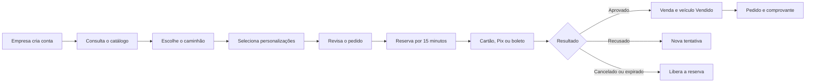
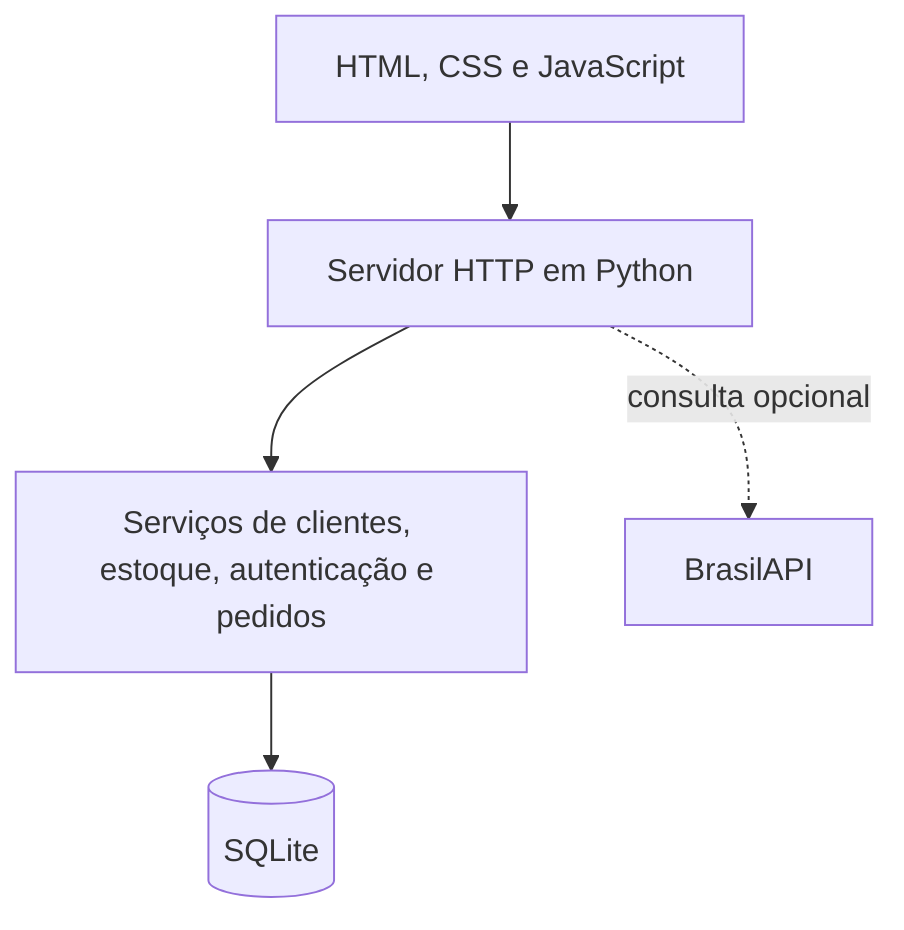

# FasTruck — Guia para montar a apresentação

Data: 25/11/2026.

## 1. Identidade e mensagem principal

- Nome: **FasTruck**.
- Cor principal: azul-marinho.
- Tipo de produto: e-commerce de caminhões voltado a empresas.
- Diferencial: personalização do caminhão integrada ao pedido.
- Entrega atual: cadastro e ciclo de estoque, clientes PJ, loja, checkout, pagamento, pedidos, vendas e histórico.

Mensagem curta sugerida: **“A FasTruck reúne estoque, personalização e compra empresarial de caminhões em um único fluxo.”**

## 2. Escopo que deve aparecer

### Módulos ativos

1. **Veículos e estoque:** cadastrar, consultar, editar, vender, arquivar e consultar excluídos.
2. **Clientes PJ:** cadastrar empresas, criar conta, consultar, editar, ativar e inativar.
3. **Loja e checkout:** catálogo, personalizações, pedido, reserva, pagamento, comprovante e acompanhamento.
4. **Vendas e histórico:** comprador, valor, evento, status Vendido e preservação dos dados.

### Conteúdo que não representa mais o produto atual

- proposta comercial administrativa separada;
- tela independente de pagamentos de propostas;
- aprovação manual de pagamento pelo administrador.

As tabelas antigas podem continuar no SQLite por compatibilidade de migração, mas não fazem parte da navegação nem do fluxo apresentado.

## 3. Fluxo principal

Na aprovação, pagamento, pedido, venda, evento e estoque são atualizados na mesma transação.

## 4. Arquitetura resumida

| Camada | Tecnologia | Responsabilidade |
|---|---|---|
| Front-end | HTML, CSS e JavaScript | Loja, painel, formulários, filtros e checkout. |
| Back-end | Python 3.10+ | API, autenticação, regras, pagamentos e transações. |
| Banco | SQLite | Veículos, empresas, contas, pedidos, pagamentos, vendas e eventos. |
| Documentação | Markdown | Requisitos, regras, riscos, casos de uso e validação. |

O sistema usa apenas a biblioteca padrão do Python e inicia com `python src/backend/app.py`.

## 5. Atores

| Ator | Ações principais |
|---|---|
| Visitante | Consulta catálogo e cria conta empresarial. |
| Cliente PJ | Personaliza, compra, paga e acompanha os próprios pedidos. |
| Administrador | Gerencia veículos e empresas; acompanha pedidos, pagamentos, vendas e histórico. |
| Sistema | Valida, calcula, reserva, processa pagamentos e mantém consistência. |

## 6. Requisitos funcionais para os slides

### Veículos

- Cadastrar caminhão com placa, marca, modelo, ano, cor, preço e status.
- Registrar carroceria, tração, combustível, quilometragem e personalização.
- Listar, pesquisar, filtrar e editar.
- Arquivar por exclusão lógica e consultar veículos excluídos.
- Registrar venda administrativa e preservar comprador, valor e eventos.
- Impedir placa duplicada e venda concorrente do mesmo caminhão.

### Clientes PJ

- Cadastrar CNPJ, razão social, contato, endereço, e-mail e senha.
- Consultar CNPJ opcionalmente e permitir preenchimento manual.
- Listar, pesquisar, editar, inativar e reativar empresas.
- Isolar conta e pedidos de cada empresa.
- Bloquear compra e venda para empresa inativa.

### Loja, pedidos e checkout

- Exibir apenas caminhões disponíveis.
- Permitir personalizações com preços calculados pelo servidor.
- Criar pedido e reservar estoque por 15 minutos.
- Processar cartão, Pix ou boleto automaticamente.
- Permitir nova tentativa após recusa.
- Cancelar pedido elegível e liberar somente sua reserva.
- Aprovar uma única venda por pedido e emitir comprovante.
- Permitir consulta dos pedidos pelo cliente e pela administração.

## 7. Regras de negócio para destacar

1. Placa é obrigatória, normalizada e única, inclusive após arquivamento.
2. Veículo arquivado não é apagado e continua com histórico consultável.
3. Apenas empresa ativa e veículo disponível podem iniciar uma compra.
4. Um pedido possui exatamente um caminhão e pode ter várias personalizações.
5. O servidor recalcula preços e ignora valores enviados pelo navegador.
6. A reserva é exclusiva, pertence a um pedido e dura 15 minutos.
7. Pagamento aprovado é único por pedido.
8. Aprovação grava pagamento, pedido, venda, evento e status Vendido atomicamente.
9. Cancelamento ou expiração libera apenas a reserva do próprio pedido.
10. Snapshots preservam os dados da compra mesmo após alterações cadastrais.
11. O administrador acompanha o pagamento e não precisa aprová-lo manualmente.

## 8. Requisitos não funcionais

- Interface responsiva, com foco visível, rótulos e mensagens compreensíveis.
- Validação e autorização aplicadas no servidor.
- Senhas armazenadas com scrypt.
- Cookie HttpOnly, SameSite e token CSRF nas alterações autenticadas.
- Textos do usuário escapados antes de aparecerem na interface.
- Valores financeiros persistidos em centavos no checkout e exibidos em BRL.
- Datas persistidas em UTC.
- Transações SQLite nas operações de reserva, pagamento e venda.
- Idempotência para evitar duplicidade por clique ou reenvio.
- Migrações aplicadas uma vez e backup antes de evoluir banco com veículos.

## 9. Premissas, restrições e riscos

### Premissas

- A empresa informa seus dados corretamente.
- O servidor local permanece ativo durante a demonstração.
- O computador possui Python 3.10+ e relógio adequado para a reserva.
- A retirada ocorre na unidade indicada no checkout.

### Restrições

- Sem frete, entrega, nota fiscal, parcelamento, estorno ou chargeback.
- Sem recuperação de senha por e-mail e sem múltiplos usuários por empresa.
- Sem integração com banco, adquirente ou rede Pix.
- Sem hospedagem pública ou sincronização entre instalações.
- Sem validação oficial de placa, propriedade ou estado mecânico.

### Riscos e respostas

| Risco | Resposta do sistema |
|---|---|
| Duas empresas escolherem o mesmo veículo | Reserva condicional e transação. |
| Clique repetido duplicar pedido ou pagamento | Chave de idempotência. |
| Navegador alterar preço ou resultado | Recalcular e decidir no servidor. |
| Falha parcial deixar dados divergentes | Rollback da transação. |
| Edição apagar contexto de compra antiga | Snapshots e eventos. |
| Perda do SQLite | Backup pré-migração e cópias manuais. |
| Consulta de CNPJ ficar indisponível | Cadastro manual continua funcionando. |

## 10. Casos de uso principais

| Caso | Ator | Resultado |
|---|---|---|
| Cadastrar caminhão | Administrador | Veículo disponível no estoque e no catálogo quando elegível. |
| Editar caminhão | Administrador | Dados atualizados e histórico comercial preservado. |
| Arquivar e consultar excluído | Administrador | Sai do estoque ativo sem apagar placa, venda ou eventos. |
| Registrar venda | Administrador | Comprador, valor, evento e status Vendido gravados. |
| Criar conta PJ | Visitante | Empresa, conta e sessão criadas juntas. |
| Personalizar caminhão | Cliente PJ | Itens e total preparados para revisão. |
| Criar e pagar pedido | Cliente PJ | Reserva, pagamento e venda processados. |
| Consultar pedido | Cliente PJ | Visualiza apenas seus pedidos e comprovantes. |
| Acompanhar operação | Administrador | Consulta pedidos, pagamentos, empresas e vendas. |

Os fluxos completos e as alternativas estão nos documentos específicos de cada módulo.

## 11. Dados disponíveis para a demonstração

- Banco novo: 13 caminhões e 7 empresas acadêmicas.
- Conta compradora:
  - e-mail: `compras@horizonteazul.com.br`
  - senha: `teste123`
- Administração: abrir **Admin** no cabeçalho e usar **Preencher login**.
- Cartão corporativo final `4242`: aprovado após processamento.
- Cartão alternativo final `0002`: recusado e permite nova tentativa.
- Pix: confirmado automaticamente.
- Boleto: compensado automaticamente.

O banco local não vai para o Git. Migrações e cargas versionadas recriam os exemplos em cada instalação.

## 12. Demonstração sugerida

1. Abrir a loja e mostrar o catálogo.
2. Entrar com a empresa acadêmica.
3. Escolher um caminhão e adicionar uma personalização.
4. Revisar empresa, veículo, retirada e total.
5. Pagar com cartão 4242, Pix ou boleto.
6. Abrir **Meus pedidos** e o comprovante.
7. Usar **Admin** no cabeçalho e preencher o login.
8. Mostrar **Pedidos da loja** e a venda criada.
9. No estoque, cadastrar ou editar um caminhão.
10. Arquivar um veículo elegível e abrir **Veículos excluídos**.

Evitar comprar um caminhão necessário para outra etapa da demonstração, pois uma compra aprovada altera o status para Vendido.

## 13. Ordem sugerida dos slides

1. Capa e identidade FasTruck.
2. Problema e objetivo do projeto.
3. Visão geral da solução.
4. Tecnologias e arquitetura.
5. Atores.
6. Módulo de veículos e dados cadastrados.
7. Fluxo CRUD: Create, Read, Update e Delete lógico.
8. Venda, arquivamento e histórico.
9. Módulo de clientes PJ.
10. Loja, catálogo e personalização.
11. Fluxo do checkout e formas de pagamento.
12. Regras de negócio.
13. Requisitos funcionais.
14. Requisitos não funcionais.
15. Premissas, restrições e riscos.
16. Casos de uso.
17. Banco, carga inicial e estrutura de pastas.
18. Validação e cenários exercitados.
19. Demonstração e conclusão.

## 14. Fonte de cada parte

| Assunto | Documento principal |
|---|---|
| Visão geral e integração | [PLANO-NOVOS-MODULOS.md](PLANO-NOVOS-MODULOS.md) |
| CRUD, estoque, venda e excluídos | [REQUISITOS-CADASTRO-VEICULOS.md](REQUISITOS-CADASTRO-VEICULOS.md) |
| Empresas e CNPJ | [REQUISITOS-CLIENTES-PJ.md](REQUISITOS-CLIENTES-PJ.md) |
| Loja, checkout, pagamentos e pedidos | [REQUISITOS-AREA-CLIENTE.md](REQUISITOS-AREA-CLIENTE.md) |
| Testes e limites da validação | [VALIDACAO-MODULOS.md](VALIDACAO-MODULOS.md) |
| Instalação, acessos e pastas | [README.md](../README.md) |

## 15. Divisão simples entre colegas

- Pessoa 1: contexto, objetivo, identidade, arquitetura e tecnologias.
- Pessoa 2: veículos, CRUD, venda, exclusão lógica e histórico.
- Pessoa 3: clientes PJ, catálogo, personalização e checkout.
- Pessoa 4: requisitos, regras, riscos, casos de uso, validação e conclusão.

Cada slide deve usar frases curtas. Os detalhes completos permanecem nos documentos de requisitos para responder perguntas da banca.
